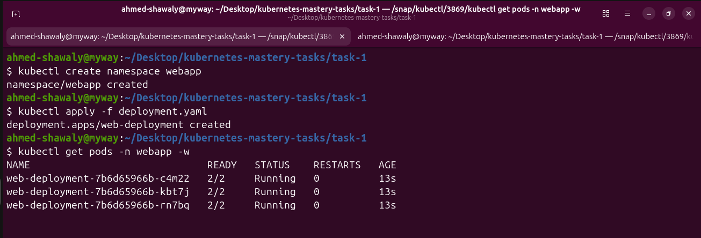
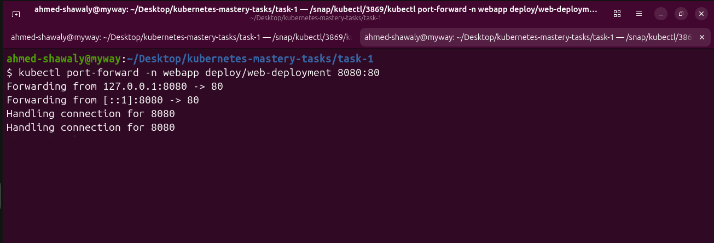
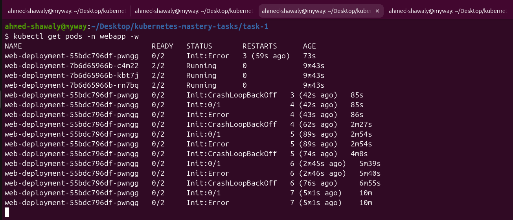
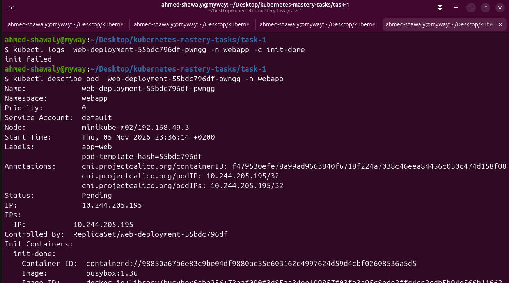
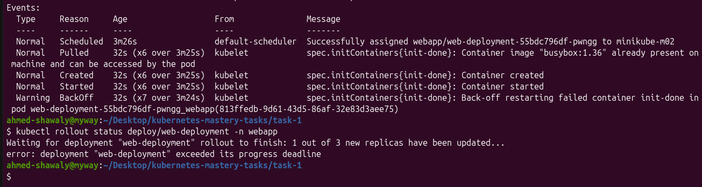
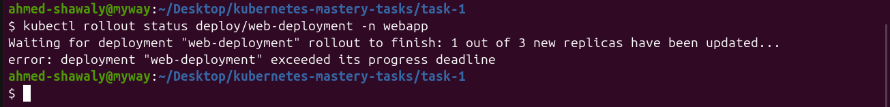

# Task 1: Multi-container Pods (Init Container & Sidecar)


Manifest: [`deployment.yaml`](./deployment.yaml)

## 1. Create the namespace and deploy


All 3 Pods reach `2/2 Running`.



## 2. Port-forward and open the page




Page at `http://localhost:8080`:


After refreshing, the time changed (the sidecar is updating it):


## 3. Make the init container fail

I changed only the init command to `sh -c "echo 'init failed'; exit 1"` and applied again:


The new Pod goes `Init:Error` → `Init:CrashLoopBackOff`, `READY 0/2`. The 3 old Pods stay `2/2 Running`.



Logs and describe of the new Pod:




Events show the `BackOff` warning for `init-done`:



Rollout status gives `exceeded its progress deadline`:

```bash
kubectl rollout status deploy/web-deployment -n webapp
```



## Answers

**Which status does the new Pod show?**
`Init:Error`, then `Init:CrashLoopBackOff` (READY `0/2`). The `init-done` container exits with code 1, and the kubelet keeps restarting it with an increasing back-off delay.

**Do `nginx` and `time-updater` start?**
No. Init containers must finish successfully before the main containers start, so both stay waiting.

**Is the page still reachable, and why?**
Yes. The Deployment uses a rolling update, so it keeps the old Pods until the new Pod is ready. The new Pod never becomes ready, so the 3 old Pods (`2/2 Running`) keep serving the page, and the rollout stops at "1 out of 3 new replicas updated" until the progress deadline is exceeded.

## 4. Fix it

Put the working init command back (`sh -c "echo done"`) and apply again:

```bash
kubectl apply -f deployment.yaml
kubectl get deploy web-deployment -n webapp   # READY 3/3, UP-TO-DATE 3
```