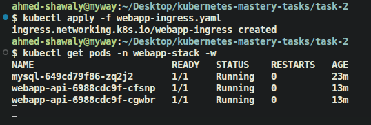
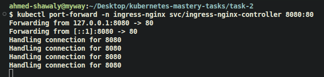
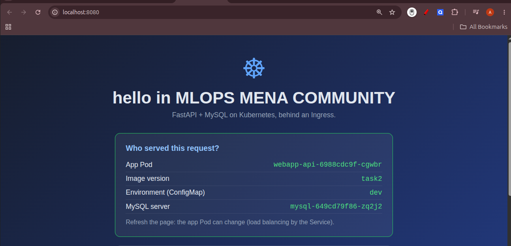
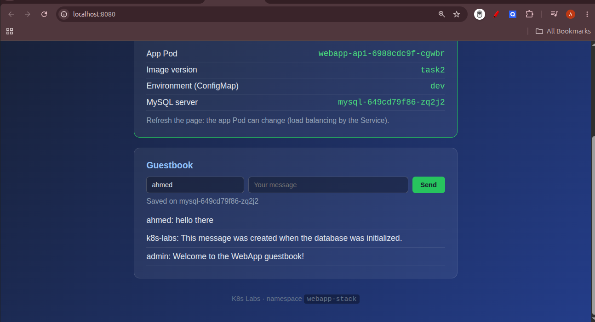
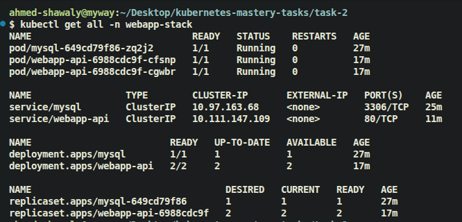

# Task 2: FastAPI + MySQL on Kubernetes (ConfigMap, Secret, PV/PVC & Ingress)


## Folder Structure

```
task-2/
├── webapp/                  # FastAPI app + Dockerfile (provided)
├── mysql/                   # MySQL image + Dockerfile (provided)
├── mysql-secret.yaml        # Secret with MySQL credentials
├── webapp-configmap.yaml    # ConfigMap with app settings
├── mysql-pv-pvc.yaml        # PV + PVC 
├── mysql-deploy.yaml        # MySQL Deployment
├── mysql-service.yaml       # MySQL Service
├── webapp-deploy.yaml       # App Deployment
├── webapp-service.yaml      # App Service
├── webapp-ingress.yaml      # Ingress
└── imgs/                    # Screenshots
```


## Screenshots

### Ingress created and Pods running


### Port-forward to the Ingress Controller


### App home page 





### All resources in `webapp-stack`


